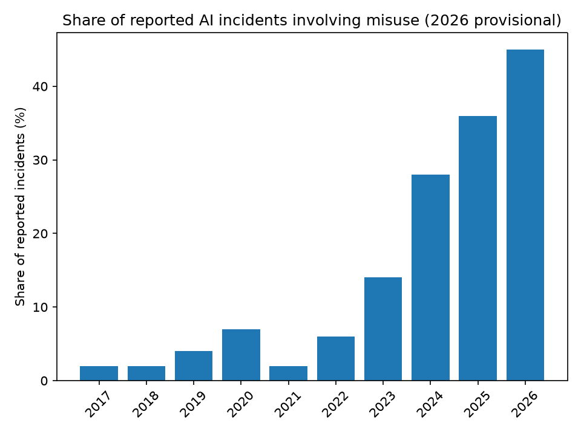

# AI incident trends

**Question:** What do public records of AI incidents show about how often things go wrong, who is involved, and whether misuse is growing?

## Findings

- **Reported incidents have risen sharply:** a handful a year until about 2014, then a surge from 2022 to a peak of 463 in 2025. 2026 is provisional.
- **Misuse is a growing share.** Incidents whose deployers include scammers, deepfake creators or other bad actors rose from under 10% a year before 2023 to 36% in 2025.
- **Developers and deployers differ.** OpenAI is named as developer in 195 incidents but as deployer in 86, because many incidents involve other people using its models.

## Method

- `ai_incidents.py`: counts incidents per year.
- `ai_developers.py`: splits incidents involving several companies, then compares how often each is named as developer and as deployer.
- `ai_misuse.py`: marks incidents involving five misuse categories and calculates their share of each year's incidents.

## Limitations

- The database records only incidents that become public, mostly through the news, so the true total is unknown.
- Visible harms, such as scams, are more likely to be reported than quiet ones, such as biased automated decisions, so misuse may be over-represented.
- The data records who was involved, not who was to blame.
- Category labels have changed over time, which may account for part of the trend.
- Counts are not risk: companies with more users are named in more incidents.

## Data and licence

Data: [AI Incident Database](https://incidentdatabase.ai/research/snapshots/) snapshot of 2 November 2026, licensed under [CC BY-SA 4.0](https://creativecommons.org/licenses/by-sa/4.0/). Counts and charts derived from it are shared under the same licence. Linked news reports remain subject to their own copyright.

To run the code, download the snapshot, unpack it, and change the file path in each script to point to `incidents.csv`.
